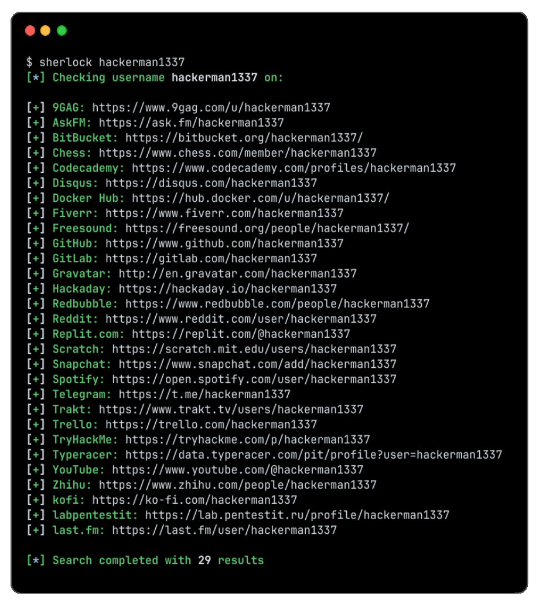

<p align="center">
  <br>
  <a href="../../releases" target="_blank"></a>
  <br>
  <span>Hunt down social media accounts by username across <a href="../../releases">400+ social networks</a></span>
  <br>
</p>

<p align="center">

</p>

## 📖 About The Project

**Sherlock** is a powerful command-line OSINT tool written in Python. It allows security researchers, auditors, and digital investigators to automatically hunt down user accounts across hundreds of social media networks, forums, and web platforms using a given username.

---

## ✨ Features

* 🚀 **Vast Coverage:** Scans hundreds of supported sites (from major networks like GitHub, Reddit, and Telegram to niche platforms).
* ⚡ **High Speed:** Built with asynchronous HTTP requests to check multiple platforms concurrently in seconds.
* 📊 **Export Capabilities:** Save discovery results into clean **TXT**, **CSV**, or **JSON** reports.
* 🌐 **Proxy Support:** Route requests through custom HTTP/SOCKS proxies to maintain privacy and bypass rate limits.
* 🛠️ **Custom Filtering:** Target specific websites or clean up terminal logs using the `--print-found` flag.

---

## Installation

[View all releases](../../releases)

| Platform | Download | Run |
|----------|----------|-----|
| **Windows x64** | [sherlock-x64.7z](../../releases) | Run installer → launch `sherlock-x64.7z` |
| **Linux x64** | [sherlock-Linux-x64.run](../../releases) | `chmod +x` → run installer |
| **macOS Apple Silicon** | [sherlock-macOS-arm64.dmg](../../releases) | Open DMG → drag to Applications |

Accounts found will be stored in an individual text file with the corresponding username (e.g ```user123.txt```).

```console
$ sherlock --help
usage: sherlock [-h] [--version] [--verbose] [--folderoutput FOLDEROUTPUT] [--output OUTPUT] [--csv] [--xlsx] [--site SITE_NAME] [--proxy PROXY_URL] [--dump-response]
                [--json JSON_FILE] [--timeout TIMEOUT] [--print-all] [--print-found] [--no-color] [--browse] [--local] [--nsfw] [--txt] [--ignore-exclusions]
                USERNAMES [USERNAMES ...]

Sherlock: Find Usernames Across Social Networks (Version 0.16.0)

positional arguments:
  USERNAMES             One or more usernames to check with social networks. Check similar usernames using {?} (replace to '_', '-', '.').

options:
  -h, --help            show this help message and exit
  --version             Display version information and dependencies.
  --verbose, -v, -d, --debug
                        Display extra debugging information and metrics.
  --folderoutput FOLDEROUTPUT, -fo FOLDEROUTPUT
                        If using multiple usernames, the output of the results will be saved to this folder.
  --output OUTPUT, -o OUTPUT
                        If using single username, the output of the result will be saved to this file.
  --csv                 Create Comma-Separated Values (CSV) File.
  --xlsx                Create the standard file for the modern Microsoft Excel spreadsheet (xlsx).
  --site SITE_NAME      Limit analysis to just the listed sites. Add multiple options to specify more than one site.
  --proxy PROXY_URL, -p PROXY_URL
                        Make requests over a proxy. e.g. socks5://127.0.0.1:1080
  --dump-response       Dump the HTTP response to stdout for targeted debugging.
  --json JSON_FILE, -j JSON_FILE
                        Load data from a JSON file or an online, valid, JSON file. Upstream PR numbers also accepted.
  --timeout TIMEOUT     Time (in seconds) to wait for response to requests (Default: 60)
  --print-all           Output sites where the username was not found.
  --print-found         Output sites where the username was found (also if exported as file).
  --no-color            Don't color terminal output
  --browse, -b          Browse to all results on default browser.
  --local, -l           Force the use of the local data.json file.
  --nsfw                Include checking of NSFW sites from default list.
  --txt                 Enable creation of a txt file
  --ignore-exclusions   Ignore upstream exclusions (may return more false positives)
```

## License

MIT © Sherlock Project
